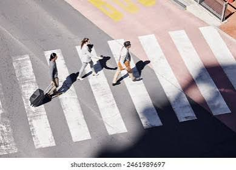
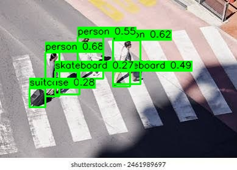

# YOLO26 Object Detection with OpenCV (C++)

A small C++ program that runs a YOLO26n object detector on an image using OpenCV's DNN module. It preprocesses the image, runs the exported ONNX model, decodes the output tensor, and produces both an annotated image and the raw detection data.




## Quick start (Docker, recommended)

The included `Dockerfile` builds everything for you: OpenCV 4.11, the detector, and the exported `yolo26.onnx` model. The only thing you need installed is [Docker](https://docs.docker.com/get-docker/).

```bash
git clone https://github.com/llaammbbddaa/objectDetection
cd objectDetection

# Build the image (the first build takes a while, see notes below)
docker build -t yolo26-detect .

# Run it on the example image
docker run --rm --user "$(id -u):$(id -g)" -v "$PWD":/data yolo26-detect image.jpg
```

Results are written to `annotated.jpg` and `detections.csv` in your current directory, and the detections are also printed to the console.

To run on your own image, put it in the folder you mount and pass its filename. Optional confidence and NMS thresholds go after it:

```bash
docker run --rm --user "$(id -u):$(id -g)" -v "$PWD":/data yolo26-detect my_photo.jpg 0.25 0.45
#                                                                                      ^conf ^nms
```

To subdivide an image before inference, provide its resolution with
`--resolution WIDTHxHEIGHT`. The program uses
`ceil(width / 640) * ceil(height / 640)` evenly spaced tiles, translates
detections back to the original image, and applies NMS to remove duplicates:

```bash
docker run --rm --user "$(id -u):$(id -g)" -v "$PWD":/data yolo26-detect \
  my_photo.jpg --resolution 1280x720
docker run --rm --user "$(id -u):$(id -g)" -v "$PWD":/data yolo26-detect \
  my_photo.jpg --resolution 2048x1080 0.25 0.45
```

To process every image in a directory, pass separate output directories for
the CSV files and annotated images:

```bash
docker run --rm --user "$(id -u):$(id -g)" -v "$PWD":/data yolo26-detect \
  images csv_output annotated_output 0.25 0.45
#       ^input  ^CSV output ^image output ^conf ^nms
```

The output directories are created when needed. Each input image produces
`<name>.csv` in the CSV directory and `<name>_annotated.<extension>` in the
annotated-image directory. Files that are not readable images are skipped and
reported.

Notes:

- **First build is slow.** OpenCV is compiled from source and the model is downloaded and exported. Later builds reuse Docker's cache.
- **The build checks the model.** A smoke test loads the exported model with OpenCV and runs one forward pass, so an incompatible model fails `docker build` instead of failing when you run it.
- **The build needs internet access** to fetch the OpenCV source and `yolo26n.pt`.
- **The model is bundled in the image**, so you don't need a local `yolo26.onnx`. If you place your own `yolo26.onnx` in the mounted folder, that one is used instead.
- **`--user "$(id -u):$(id -g)"`** makes the output files owned by you rather than root. It's optional.
- **Your image must be inside the mounted folder**, because the container only sees what you mount at `/data`.

## What it does

Given an input image, the program:

1. **Preprocesses** the image into the format YOLO26 expects: a 640x640 RGB blob scaled to the 0-1 range. The image is *letterboxed* (resized with its aspect ratio preserved, then padded with gray) so objects aren't distorted.
2. **Runs inference** with `cv::dnn::Net` on the exported `yolo26.onnx` model.
3. **Decodes the output tensor.** YOLO26 is *end-to-end* by default: the exported model outputs a `[1, 300, 6]` tensor with up to 300 final detections, each row being `x1, y1, x2, y2, confidence, class_id` in 640x640 letterboxed pixels. Duplicates are already removed inside the model, so no NMS is needed. (The program also supports the classic `[1, 84, 8400]` layout from an `end2end=False` export; see below.)
4. **Filters and cleans up** the detections: discards low-confidence boxes and maps coordinates back to the original image (undoing the letterbox padding and scaling). With the classic layout it also applies non-maximum suppression (NMS).
5. **Outputs the results:**
   - `annotated.jpg`: the original image with labeled bounding boxes
   - `detections.csv`: one row per detection
   - The same data printed to the console

When the input is a directory, the same processing is applied independently to
each image in that directory. Without `--resolution`, each source image is
divided into four quadrants before inference. With `--resolution`, it is
divided into `ceil(width / 640) * ceil(height / 640)` tiles. Detections from
each tile are translated back to the original image coordinates, merged (with
NMS to remove duplicates across tile borders), and annotated on the full-size
source image. The CSV and annotated-image output locations are provided as the
second and third arguments. If omitted, they default to `csv_output` and
`annotated_output`.

### Output format

Each detection has the following fields:

| Column | Description |
|---|---|
| `x1`, `y1` | Top-left corner of the box (pixels, original image) |
| `x2`, `y2` | Bottom-right corner of the box (pixels, original image) |
| `confidence` | Class score, 0 to 1 |
| `class_id` | COCO class index (0-79) |
| `class_name` | Human-readable class name (CSV and console only) |

### Run options

| Argument | Default | Meaning |
|---|---|---|
| `conf` | `0.25` | Minimum class score to keep a detection |
| `nms` | `0.45` | IoU threshold for suppressing overlapping boxes. Only used for the classic export layout and for merging tiles in split mode; a single image with the default end-to-end model ignores it |
| `--resolution WIDTHxHEIGHT` | unset | Use `ceil(width / 640) * ceil(height / 640)` evenly spaced inference tiles; output coordinates remain relative to the original image |

## Manual setup (without Docker)

Only follow this section if you can't or don't want to use Docker.

### Requirements

- A C++14 compiler (e.g. GCC) and CMake 3.10+
- **OpenCV 4.11** (built with the `core`, `imgproc`, `imgcodecs`, and `dnn` modules)
- Python with the [Ultralytics](https://docs.ultralytics.com/) package, only needed once to export the model

> **Note:** older OpenCV versions (e.g. 4.5.4) have an ONNX importer that lacks support for layers used by recent YOLO models and fail during inference. Use OpenCV 4.11. If the end-to-end model fails to load or run on your OpenCV build, re-export with `end2end=False` (see step 3).

### 1. Install build tools

```bash
sudo apt update
sudo apt install -y build-essential cmake git
```

### 2. Install OpenCV

If your package manager provides OpenCV 4.11, you can install it directly (`sudo apt install libopencv-dev`) and check with `pkg-config --modversion opencv4`. Otherwise, build it from source into your home directory:

```bash
cd ~
git clone --depth 1 --branch 4.11.0 https://github.com/opencv/opencv.git
mkdir -p opencv/build && cd opencv/build
cmake -DCMAKE_BUILD_TYPE=Release \
      -DCMAKE_INSTALL_PREFIX=$HOME/opencv-4.11 \
      -DBUILD_LIST=core,imgproc,imgcodecs,dnn \
      -DBUILD_TESTS=OFF -DBUILD_PERF_TESTS=OFF -DBUILD_EXAMPLES=OFF ..
make -j$(nproc) && make install
```

### 3. Export the YOLO26n model

```bash
pip install ultralytics
yolo export model=yolo26n.pt format=onnx opset=12 simplify=True
mv yolo26n.onnx yolo26.onnx
```

The program looks for a file named **`yolo26.onnx`** in the working directory.

If OpenCV can't load or run that model, export the classic layout instead (the program detects it automatically):

```bash
yolo export model=yolo26n.pt format=onnx opset=12 simplify=True end2end=False
mv yolo26n.onnx yolo26.onnx
```

With Docker, the equivalent is `docker build --build-arg END2END=False -t yolo26-detect .`

### 4. Build

```bash
git clone https://github.com/llaammbbddaa/objectDetection
cd objectDetection
mkdir build && cd build

# If OpenCV is installed system-wide:
cmake ..
# If you built OpenCV into your home directory as above:
# cmake -DOpenCV_DIR=$HOME/opencv-4.11/lib/cmake/opencv4 ..

make
cd ..
```

### 5. Run

Place `yolo26.onnx` in the directory you run from, then:

```bash
./build/yolo26_detect input.jpg
```

With optional thresholds:

```bash
./build/yolo26_detect input.jpg 0.25 0.45
#                               ^conf ^nms
```

To use resolution-driven tiling:

```bash
./build/yolo26_detect input.jpg --resolution 1280x720
./build/yolo26_detect input.jpg --resolution 2048x1080 0.25 0.45
```

Results are written to `annotated.jpg` and `detections.csv` in the current directory.

For a directory:

```bash
./build/yolo26_detect images csv_output annotated_output
./build/yolo26_detect images csv_output annotated_output 0.25 0.45
./build/yolo26_detect images csv_output annotated_output --resolution 2048x1080
```

## Code overview

Everything lives in `main.cpp`:

| Piece | Purpose |
|---|---|
| `letterbox()` | Resizes with preserved aspect ratio and pads to 640x640; returns the scale and padding needed to map boxes back to the original image |
| `blobFromImage()` | Converts the image to a `[1,3,640,640]` float blob (1/255 scale, BGR to RGB) |
| `net.forward()` | Runs the model and returns either the `[1,300,6]` end-to-end output or the classic `[1,84,8400]` output |
| Decode step | End-to-end layout: reads each `x1,y1,x2,y2,score,class` row, filters by confidence and undoes the letterbox. Classic layout: transposes the output, finds the best class per row, converts center/size boxes to corners, then undoes the letterbox |
| `cv::dnn::NMSBoxes()` | Removes overlapping duplicates (classic layout, and merging tiles in split mode) |
| Output section | Builds the N x 6 tensor, writes the CSV and console table, and draws the annotated image |

## Troubleshooting

**Docker**

- **`docker build` fails at the smoke test:** OpenCV couldn't run the exported model. Retry with `--build-arg END2END=False`.
- **`docker build` fails while downloading:** the build needs internet access to fetch the OpenCV source and `yolo26n.pt`. Check your connection or proxy settings and retry.
- **Input image not found:** the container only sees the folder you mount with `-v "$PWD":/data`. Make sure the image is in that folder and you pass just its filename.
- **Output files are owned by root:** add `--user "$(id -u):$(id -g)"` to the `docker run` command.

**Manual setup**

- **`Failed to load yolo26.onnx`**: the model file isn't in the directory you ran the program from, or it's misnamed.
- **Assertion or parse error while loading/running the model**: your OpenCV is too old, or it can't handle the end-to-end graph; see the note under Requirements and try the `end2end=False` export.
- **CMake can't find OpenCV**: point it at your install with `-DOpenCV_DIR=<path to lib/cmake/opencv4>`.

**Both**

- **No detections**: try lowering the confidence threshold, e.g. `yolo26-detect image.jpg 0.1` (or `./build/yolo26_detect image.jpg 0.1` without Docker).

## Project structure

```
.
├── CMakeLists.txt   # build configuration
├── Dockerfile       # builds OpenCV, the detector and the model (recommended way to run)
├── main.cpp         # preprocessing, inference, decoding, annotation
├── README.md
└── .gitignore
```

The model (`yolo26.onnx`) and generated outputs are not tracked in git; see `.gitignore`.
